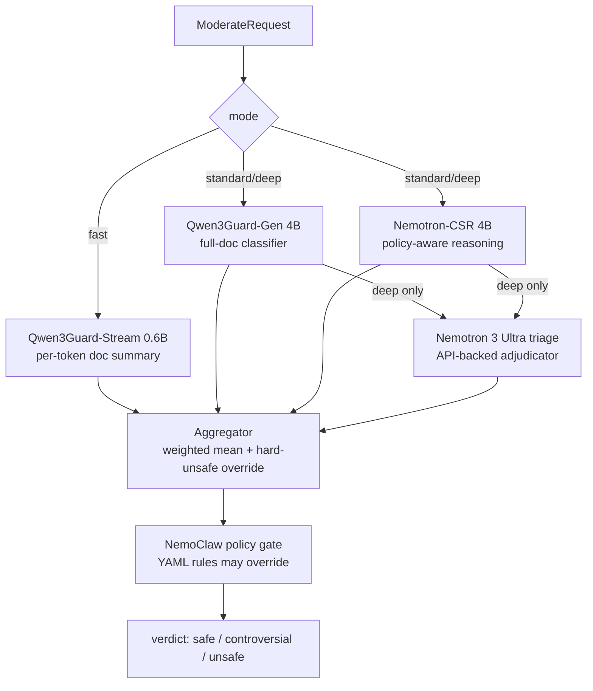

# nemoguardian architecture

One FastAPI process wraps three concerns: the **moderation cascade** (local guard
models + API triage), the **policy gate** (NemoClaw YAML rules), and the
**billing/provisioning control plane** (SQLite + Stripe + GPU providers).

## The cascade

- Models load lazily on first use and are cached as singletons on the `Cascade`.
- Default checkpoints are pinned to full commit SHAs (`revision=`); see
  `NEMOGUARDIAN_*_REVISION` in `.env.example`.
- Weights: Qwen 0.40, CSR 0.40, triage 0.20. Any model reporting `unsafe` with
  score ≥ 0.50 overrides the mean to `unsafe`.
- Thresholds are strict (`>`): mean ≤ 0.30 safe, ≤ 0.70 controversial, else unsafe.

### Failure contract

This is the part worth memorizing:

1. A model that crashes or produces unparseable output **never raises** — it returns
   a verdict with `error` set (`models/base.py`).
2. Errored verdicts are **excluded** from aggregation: they don't vote safe *or*
   unsafe, and the failure is surfaced in `reasons`. Partial failure = graceful
   degradation.
3. If **no** model contributed, the verdict follows `NEMOGUARDIAN_FAIL_MODE`:
   `closed` (default) → `unsafe`, `open` → `safe`. A moderation outage blocks
   content unless the operator explicitly opts into availability-over-safety.
4. Parse drift is loud by design: Qwen/CSR output that doesn't match the expected
   format raises (→ error verdict) instead of silently reading as "safe".

## Request path (`POST /v1/moderate`)

0. The ASGI rate-limit + body-size middleware runs before the route (429 +
   `Retry-After` when a positive `NEMOGUARDIAN_RATE_LIMIT` is exceeded).
1. `require_api_key` — SHA-256 key lookup (off the event loop via `to_thread`);
   `last_used_at` write throttled to once/key/60 s. Env-bootstrap key supported for
   self-hosted.
2. Feature gate (402 if the tier lacks the mode) → monthly allowance check (429).
3. Inference runs in `asyncio.to_thread` (models hold the GIL-releasing torch work).
4. Usage recorded (SQLite; Stripe meter event when configured) — also off-loop.
5. Errors return sanitized `{error, correlation_id}`; details stay in server logs.

## Billing / control plane

- **SQLite** (`billing/db.py`), single shared connection, WAL + busy_timeout,
  deliberately demo-grade — the schema ports to Postgres for production. Default
  path `~/.nemoguardian/nemoguardian.db` (Docker: `/var/lib/nemoguardian`).
- **API keys** are hash-only at rest and carry a `scope`: `full` (customer master
  keys) or `instance` (moderation-only, minted per provisioned VM, quota-exempt,
  revoked on failed provisions). `require_full_scope` guards
  key-management/portal/provisioning routes.
- **Stripe**: checkout + customer portal + webhooks (HMAC signature, timestamp
  tolerance, event-id idempotency, fail-closed without a secret). Usage push
  prefers Billing Meter Events with a legacy usage-record fallback.
- **Providers** (`providers/`): a memoized registry of 9 GPU clouds. Vast.ai is a
  live REST client (cached-catalog fallback); the rest are honest stubs with real
  cached prices. `provision_cheapest_fit` picks the cheapest offer with enough
  VRAM for the cascade.

## Operational limits

- Rate limiting is in-process (matches the one-worker deploy); multi-worker/node
  deployments need proxy-layer limiting too.
- Local inference has no wall-clock timeout (it's your GPU); the network-bound
  triage call does (`NEMOGUARDIAN_TRIAGE_TIMEOUT_S`).
- Adversarial robustness of the guard models themselves is tracked as NMG-006;
  the measurement harness lives in `eval/`.
